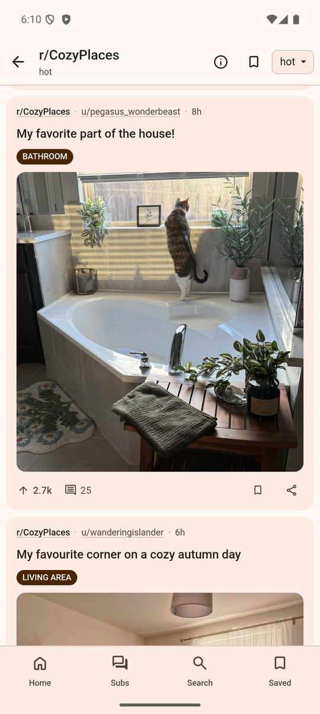
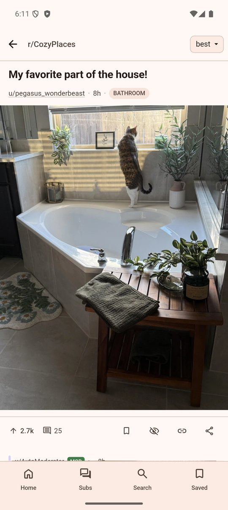
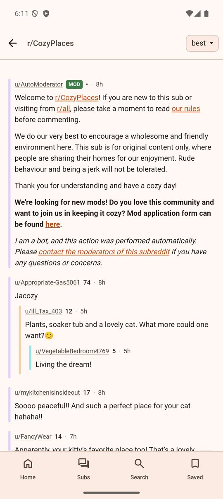
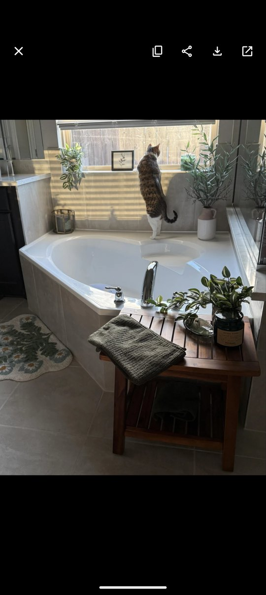
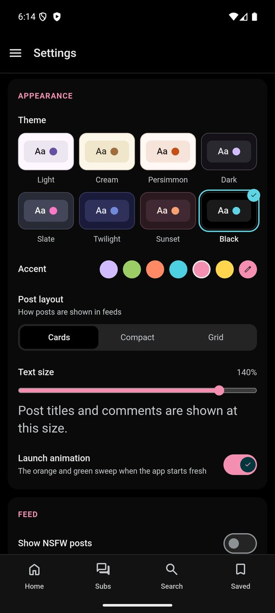
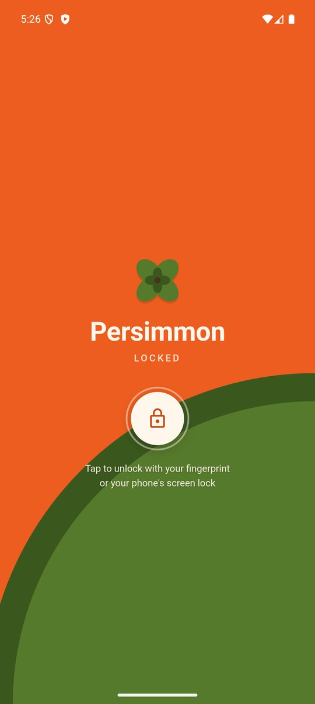

# 🍊 Persimmon

A read-only Reddit client for Android. No account, no ads, no tracking.

Persimmon is for reading Reddit and nothing else: feeds, posts, comments, pictures and video, in an app that opens fast, remembers where you were, and never asks you to sign in or install anything.

[**Download the latest release**](https://github.com/BoundingBears/PersimmonReddit/releases/latest)

<p align="center">
  
  
  
  
</p>
<p align="center">
  
  
  
</p>

## What it does

**Reading**

- Front page, r/all, r/popular and any subreddit, in three layouts: cards, compact, or a picture grid
- Posts open instantly on top of the feed, and Back puts you exactly where you were
- Comments, sortable by best, top, new and more
- Reddit video with sound, and YouTube, Twitch and Streamable clips that play inside the post
- A fullscreen image viewer: swipe up and down through galleries, pinch or double-tap to zoom, copy, share or save the picture
- Search posts, subreddits and users, or paste a Reddit link into Search to jump straight to it
- Reddit links from your browser and other apps can open in Persimmon

**Your own Reddit, kept on your phone**

- Subscribe to subreddits and read them as one merged feed, or group them into custom feeds
- Save posts. A saved post is downloaded (text, comments and pictures), so it opens with no connection
- A private folder for saved posts you want kept apart, with an optional fingerprint or screen-lock on the folder or on the whole app
- Hide posts, mute subreddits, keywords and sites, and block users
- Posts you have opened can be greyed out or hidden
- Back up everything to a file and restore it on another phone

**Looks and feel**

- Eight themes, a custom accent colour and adjustable text size
- If Android closes the app in the background, it reopens on the page and position you left
- Updates are offered inside the app; no need to come back here

## What it does not do

Persimmon never logs in to Reddit, so it cannot vote, comment, post or message. Subscriptions, saved posts and everything else you set up live only on your phone. If you need your Reddit account, this is not the app for it.

## Privacy

- No account, no analytics, no ads, no third-party SDKs
- The app talks to Reddit, to whichever site a post's media comes from when you view it (YouTube, Twitch, an image host), and to GitHub once a day to check for a new release. Nothing else
- Everything you save or subscribe to is stored on the device
- The lock on the private folder is a privacy screen, not encryption. Private posts are left out of backups on purpose, so uninstalling the app removes them

## Will it keep working?

That is up to Reddit. Persimmon reads Reddit's public pages the way a logged-out web browser does, with no API key. In 2026 Reddit announced that it is closing access of that kind and ending public API access for third-party apps in March 2027, apart from apps with a written agreement.

The app works today. It may stop without notice, and that is outside this project's control. The code already includes the official OAuth route, switched off, for the day Reddit grants this app access.

## Install

1. Download the newest `.apk` from the [Releases page](https://github.com/BoundingBears/PersimmonReddit/releases/latest).
2. Open it on your phone and allow the install. Android will warn that it did not come from the Play Store; the file is signed, just not distributed by Google.
3. Later versions are offered inside the app and install over the top, keeping your data.

Android only for now. To let Reddit links open in Persimmon, turn it on in Settings, under "Open Reddit links in Persimmon".

Moving to a new phone: in Settings choose Export backup on the old phone, send the file across, then Import backup on the new one (or just tap the `.persimmon` file and pick Persimmon).

## Build it yourself

You need Node.js 22 or newer, a JDK 17 or newer, and the Android SDK (Android Studio brings the last two).

```sh
git clone https://github.com/BoundingBears/PersimmonReddit.git
cd PersimmonReddit
npm install
npm run install:android   # builds the web app, syncs it, installs a debug APK
```

If your default Java is older than 17, point Gradle at Android Studio's bundled one in `~/.gradle/gradle.properties`:

```properties
# macOS
org.gradle.java.home=/Applications/Android Studio.app/Contents/jbr/Contents/Home
# Windows
# org.gradle.java.home=C\:\\Program Files\\Android\\Android Studio\\jbr
```

Other commands:

| Command | What it does |
| --- | --- |
| `npm run dev` | Runs the interface in a desktop browser at `localhost:5173`. Reddit may refuse requests from there; an emulator is the reliable way to see real data. |
| `npm run test` | Unit tests: Reddit parsing against recorded responses, link handling, video embeds, session restore, the OAuth client. |
| `npm run check` | Type-checks the project. |

### How it is built

- [SvelteKit](https://svelte.dev/) in single-page mode with TypeScript, wrapped for Android by [Capacitor 8](https://capacitorjs.com/)
- [hls.js](https://github.com/video-dev/hls.js) for Reddit video, which arrives as separate picture and sound streams
- [marked](https://github.com/markedjs/marked) and [DOMPurify](https://github.com/cure53/DOMPurify) to render post and comment text safely
- A handful of small native plugins in [`android/app/src/main/java/com/persimmon/app/`](android/app/src/main/java/com/persimmon/app/): the Reddit fetcher, the in-app updater, the unlock prompt, copying an image to the clipboard, shrinking very large images for zooming
- All Reddit access goes through [`src/lib/reddit/`](src/lib/reddit/)

## Contributing

Bug reports and ideas are welcome: [open an issue](https://github.com/BoundingBears/PersimmonReddit/issues). "This post renders wrong" with a link to the post is a perfect report. Pull requests are welcome too; for anything large, open an issue first so we can agree on the shape of it.

## Support

Persimmon is free and will stay free, with no ads and no paid tier. If you would like to leave a tip: [ko-fi.com/boundingbears](https://ko-fi.com/boundingbears).

## License

[MIT](LICENSE).

Persimmon is not affiliated with, endorsed by, or sponsored by Reddit, Inc. "Reddit" is a trademark of Reddit, Inc.
